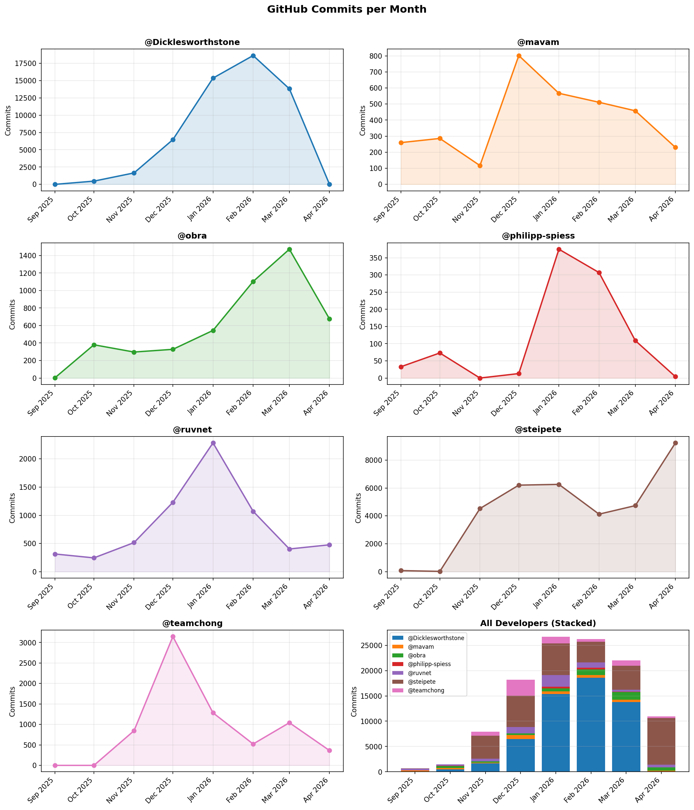

# What are they doing? A Commit-Level Dataset of Hyperactive AI-augmented Developers on GitHub 

This dataset captures the commit activity of a curated set of highly active, agentic software developers on GitHub. For each developer, it provides full commit metadata and daily commit counts spanning the months around the agentic coding explosion.

The goal of this dataset is to enable studies of AI-augmented software engineering behavior, agent adoption patterns, repository switching, commit quality, and temporal activity rhythms. The dataset covers 9 developers from September 2025 to April 2026.

This dataset has been produced at the Bellairs'26 Workshop on Continuous Software Engineering.

---

## Data Collection Methodology

Candidate developers are identified with the following sources:
- AI coding conversation on X/Twitter
- GitHub commit-search queries
- [Gitista](https://gitista.com/)
- [committers.top](https://committers.top/)
- [claudecount.com](https://www.claudecount.com) leaderboard of Claude Code usage, cross-referenced with GitHub profiles

Selection is then performed as a qualitative curation process by a team of expert software engineering researchers. We do not rely on a single automatic rule. Instead, we combine automated evidence with manual assessment of each candidate developer and their repositories.

Our inclusion workflow has four steps:

1. **Initial screening.** We use public activity signals and commit-volume queries to identify unusually active developers who may be using AI coding tools.
2. **Heuristic agent detection.** We inspect the developer's commits with the heuristics from [`agent-mining`](https://github.com/labri-progress/agent-mining), including co-author trailers, agent-related commit message patterns, and agent-specific files or configuration traces.
3. **Manual repository and commit review.** We read repository contents, inspect commit histories, and examine commit messages, temporal activity patterns, and bursts of work across repositories.
4. **Expert judgment.** When explicit agent traces are absent or incomplete, we rely on researcher judgment to decide whether a developer should still be considered AI-augmented. In those cases, the decision is based on the overall pattern of evidence, including message style, cadence, sustained commit frequency, and repository-level context.

In other words, the dataset is intentionally **curated rather than mechanically filtered**. Explicit agent signals strengthen the evidence, but they are not required in every included case. Some developers leave strong machine-readable traces; others are included because expert review indicates that their working style is consistent with AI-augmented software engineering.

## Covered Developers

| Handle | Analysis | One liner presentation |
|---|---|---|
| [steipete](https://github.com/steipete)  | [steipete.md](steipete.md) | The creator of Clawdbot/OpenClaw, extremely active and visible on social media about AI coding |
| [Dicklesworthstone](https://github.com/Dicklesworthstone) | [Dicklesworthstone.md](DICKLESWORTHSTONE.md)  | A developer with ~20(!) $200 [Claude Code Max](https://claude.com/pricing/max) subscriptions |
| [ruvnet](https://github.com/ruvnet)  | [ruvnet.md](ruvnet.md) | An independent consultant and developer harnessing the power of AI to build high-impact software (top of GitHub's trending repositories for at least 2 days) |
| [obra](https://github.com/obra)   |[obra.md](obra.md) | A developer who just started his own company and using AI to build software |
| [philipp-spiess](https://github.com/philipp-spiess)  | [philipp-spiess.md](philipp-spiess.md) | An open-source contributor, proud vibe-coder and AI agent enthusiast |
| [mavam](https://github.com/mavam) | [mavam.md](mavam.md) | A developer and CEO working on data pipelines for security operations using Claude for productivity |
| [teamchong](https://github.com/teamchong) | [teamchong.md](teamchong.md) | A developer with a super-human burst of commit productivity followed by a fall from grace |
| [clubanderson](https://github.com/clubanderson) | [clubanderson.md](clubanderson.md) | Solo maintainer of the KubeStellar console, who engineers the codebase so that coding agents can maintain it |
| [steveyegge](https://github.com/steveyegge) | [steveyegge.md](steveyegge.md) | Creator of Beads (agent work tracking) and Gas Town (orchestration of 20-30 parallel coding agents) |

### Candidate Developers Under Evaluation

The following developers are candidates identified during screening; data collection for this group is ongoing and they are not yet part of the main dataset.

| Handle | One liner presentation |
|---|---|
| [kaptinlin](https://github.com/kaptinlin) | In the list of top Claude Code users with visible GitHub activity |
| [Dexploarer](https://github.com/Dexploarer) | Another top Claude Code user with visible GitHub activity |
| [haasonsaas](https://github.com/haasonsaas) | Top Claude Code user |
| [Gary Basin](https://github.com/gbasin) | Friend of Dicklesworthstone |
| [Brian Krabach](https://github.com/bkrabach) | Works on Microsoft Amplifier, and has a cool beard |
| [Wilson Lin](https://github.com/wilsonzlin) | The "cursor web browser guy" and a few other such projects |
| [Nirholas](https://github.com/nirholas) | 37 repos with agent activity starting ~ January, ~30K commits | 
| [Amos Wenger](https://github.com/fasterthanlime) | has a more than 10x jump in commits since december |
| [Avi Fenesh](https://github.com/avifenesh) | has a more than 10x jump in commits since this year |
| [Hunter Bown](https://github.com/Hmbown) | less impressive numbers ("only" hundreds of commits/month), but a big relative jump |
| [Jordan Hubbard](https://github.com/jordanhubbard) | hundreds to 1k+ commits per month |


### False Positives

Notes about inspected developers who appeared to be agent-supported but did not meet our qualitative inspection criteria appear in markdown files in the [false positives](false-positives) directory.

## Dataset Statistics

| Metric | Value |
| --- | --- |
| Observation window | 2025-09-01 to 2026-04-30 |
| Developers | 9 |
| Repositories | 455 |
| Commits | 146,940 |
| Commits with a detectable agent-harness signal | 48.3% |
| Most frequent harness | claude_code (69,127 commits) |

These figures are those of the paper (`paper/`), which reports the per-developer breakdown.

### Commits Over Time



The paper (RQ1) describes these trajectories.


---

## Dataset Contents

```
developers.json                    # Developer registry with metadata and repo lists
data/
  {developer}-{YYYY}-{MM}.json     # Daily commit data per developer per month
  commits/{sha}.json               # Cached per-commit file-level details
```

### Developer Registry (`developers.json`)

Each entry contains:
- `handle` — GitHub username
- `repos` — list of repositories committed to in the last 90 days

### Monthly Commit Files (`data/{developer}-{YYYY}-{MM}.json`)

Each file contains:
- `developer` — GitHub handle
- `month` — `YYYY-MM`
- `days` — dict keyed by date (`YYYY-MM-DD`), each value containing:
  - `total_count` — number of commits that day
  - `sampled` — number of commits with full metadata fetched
  - `commits` — list of raw GitHub API commit objects

---

## Scripts

All scripts live in `script/` and read a GitHub token from the system keyring
(`service="login2"`, `username="github_token"`).

The [`agent-mining`](https://github.com/labri-progress/agent-mining) repository is included as a submodule and provides the agent-detection heuristics used by `detect-agents.py`.

A GitHub personal access token with `repo` and `read:user` scopes is required, stored in the system keyring:

```python
import keyring
keyring.set_password("login2", "github_token", "<your-token>")
```

### Data Collection

| Script | Description |
|---|---|
| `collect-commits-per-day.py` | Collects all commits for a developer in a given month via the GitHub GraphQL API. Writes `data/{developer}-{YYYY-MM}.json`. Usage: `python script/collect-commits-per-day.py --developer steipete --month 2025-12` |
| `collect-commit-per-month.py` | Collects monthly commit counts for every developer in `developers.json` by iterating over their non-fork repos (avoids fork inflation). Writes results back to `developers.json`. |
| `collect-march-2026.py`, `collect-april-2026.py` | Collect one month (March or April 2026) of daily commit data for every developer in `developers.json`, after refreshing their repository lists; the April script also caches per-commit details. Usage: `python script/collect-april-2026.py [--force] [--no-refresh-repos]` |
| `collect-clubanderson.py`, `collect-steveyegge.py` | Collect the eight months (Sep 2025 to Apr 2026) of one developer added later to the dataset, then cache per-commit details. Usage: `python script/collect-clubanderson.py [--force] [--no-refresh-repos]` |
| `collect_commits_per_day_lib.py`, `collect_commit_cache_lib.py` | Shared helpers of the collection scripts: GitHub session and rate-limit back-off, daily collection per repository, per-commit cache in `data/commits/`. |
| `split-monthly-json.py` | Splits a monthly data file into two halves by size (`-1.json`, `-2.json`), for files too large for GitHub. Usage: `python script/split-monthly-json.py data/Dicklesworthstone-2026-04.json` |
| `list_repos_by_user_with_events.py` | Fetches all repos where a developer committed in the last 3 months via the GitHub GraphQL  API. |
| `collect-individual-commits.py` | Downloads per-commit file-level details for every commit SHA in `data/*.json` that is not yet cached in `data/commits/{sha}.json`. Also removes stale cache entries. Usage: `python script/collect-individual-commits.py` (optionally `--developer steipete --month 2025-12`) |

### Analysis

| Script | Description |
|---|---|
| `analyze-commits.py` | Analyses commit messages using Conventional Commits conventions (type breakdown, scopes, breaking changes). Usage: `python script/analyze-commits.py data/steipete-2025-12.json` |
| `analyze-commit-quality.py` | Scores commits as "good" or "dirty" by fetching changed files from the GitHub API and applying heuristics (focused vs scattered, test coupling, diff size, etc.). Commit details are cached in `data/commits/{sha}.json`. Usage: `python script/analyze-commit-quality.py data/steipete-2025-12.json` |
| `analyze-repo-switching.py` | Analyses how a developer switches between repositories over time (concentration, consecutive switches, bouncebacks, day-by-day timeline). Usage: `python script/analyze-repo-switching.py developers.json --author steipete --month 2025-12` |
| `visualize-file-touches.py` | Fetches per-commit file details and prints a terminal report covering file categories, change sizes, language hotspots, test/docs coupling, and engineering-signal heuristics. Usage: `python script/visualize-file-touches.py developers.json --author steipete --month 2025-12` |
| `detect-agents.py` | Detects which coding agents (Claude Code, Cursor, etc.) are used in a developer's commits via agent-mining heuristics (co-author trailers, message patterns, config files). Usage: `python script/detect-agents.py data/steipete-2025-12.json` |
| `histogram-commit-time.py` | Prints a horizontal bar chart of commit counts by UTC hour from a monthly data file. Usage: `python script/histogram-commit-time.py data/steipete-2025-12.json` |
| `analyze-work-schedule.py` | Clones every repository of the dataset (commits only) to recover each commit's local time from its Git author date, and prints per-developer shares of office-hour, night, Saturday and weekend commits (paper, RQ1). Usage: `python script/analyze-work-schedule.py data CLONE_DIR` |
| `plot-commits-over-time-separate.py` | Same chart with one subplot per developer. Saves to `data/commits-over-time-separate.png`. |

### Typical Workflow

```bash
# 1. Collect monthly commit data
python script/collect-commits-per-day.py --developer steipete --month 2025-12

# 2. Download per-commit details
python script/collect-individual-commits.py

# 3. Analyse the collected data
python script/analyze-commits.py        data/steipete-2025-12.json
python script/analyze-commit-quality.py data/steipete-2025-12.json
python script/detect-agents.py          data/steipete-2025-12.json
python script/histogram-commit-time.py  data/steipete-2025-12.json
python script/analyze-repo-switching.py developers.json --author steipete --month 2025-12
python script/visualize-file-touches.py developers.json --author steipete --month 2025-12

# 4. Visualise trends
python script/plot-commits-over-time-separate.py
```

---


## Related Work

- **[R1]** Robbes et al. (2026) present the first large-scale study (129,134 projects) of coding agent adoption on GitHub, finding an adoption rate of 15.85%–22.60% and that agent-assisted commits are larger and more feature/bugfix-oriented than human-only commits. They also release the `agent-mining` heuristics library used by this dataset's `detect-agents.py` script.

- **[R2]** Yu et al. (2024) study self-admitted LLM-generated code in GitHub projects with >5 stars: 229 projects and 696 snippets across five languages.

- **[R3]** Alam et al. (2026) analyze 8,106 fix-related PRs from five AI coding agents (AIDEV-POP dataset) to understand why AI-agent-involved PRs remain unmerged.

- **[R4]** Xu et al. (2025/2026) conduct a large-scale study of 20,000+ GitHub repositories linked to arXiv papers and identify measurable shifts in coding style (e.g., snake_case adoption, complexity, maintainability) attributable to LLM influence.

## References

[R1] Romain Robbes, Théo Matricon, Thomas Degueule, Andre Hora, and Stefano Zacchiroli.
*Agentic Much? Adoption of Coding Agents on GitHub.*
arXiv:2601.18341 [cs.SE], January 2026.
https://arxiv.org/abs/2601.18341 — Code/artifacts: https://github.com/labri-progress/agent-mining

[R2] Zhen Yu, Tao Zhang, Wentao Liao, and Jiaxin Zhu.
*Where Is Self-admitted Code Generated by Large Language Models on GitHub?*
In Proceedings of the 31st Asia-Pacific Software Engineering Conference (APSEC 2024), pp. 407–418. IEEE, 2024.

[R3] Khairul Alam, Saikat Mondal, and Banani Roy.
*Why Are AI Agent Involved Pull Requests (Fix-Related) Remain Unmerged? An Empirical Study.*
arXiv:2602.00164 [cs.SE], February 2026.
https://arxiv.org/abs/2602.00164

[R4] Yuliang Xu, Siming Huang, Mingmeng Geng, Yao Wan, Xuanhua Shi, and Dongping Chen.
*code_transformed: The Influence of Large Language Models on Code.*
In Findings of the Association for Computational Linguistics: EACL 2026.
arXiv:2506.12014 [cs.CL], June 2025 (revised February 2026).
https://arxiv.org/abs/2506.12014 — Code/data: https://github.com/ignorancex/LLM_code

---

## License

MIT

---

## Contact

Open an issue on the repository https://github.com/tdegueul/what-are-they-doing
